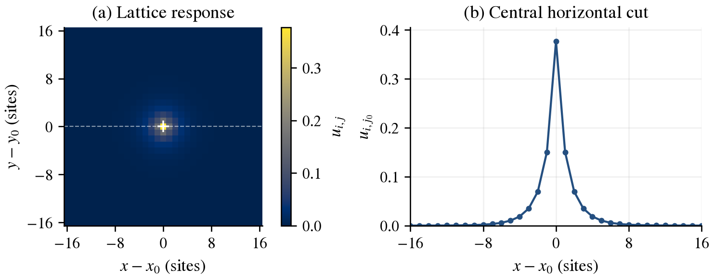
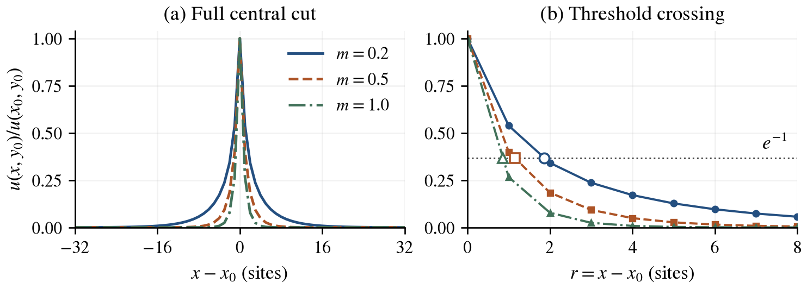
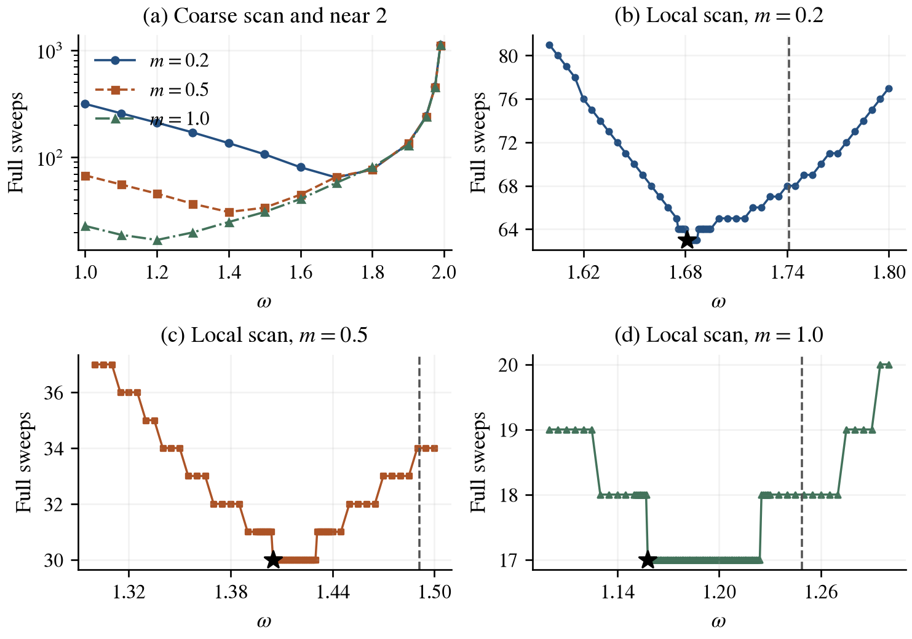
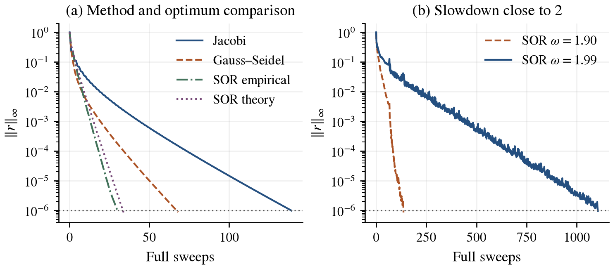
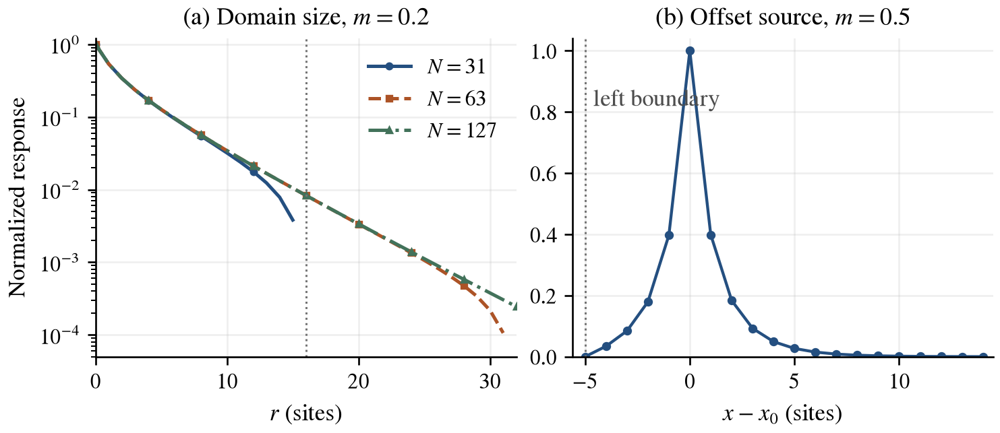

# 二维格点点源模型的 SOR 求解

计算物理第 10 周，2026 年 11 月 23 日

在 $N=63$、同为单位中心源的三组实验中，$m$ 从 0.2 增至 1.0，归一化水平响应的 $e^{-1}$ 插值距离从 1.865 降至 0.861 格。相同残差标准下，细扫选出的 SOR 较 Gauss–Seidel 分别少用 253、38、6 轮。$N=7$ 的直接解验证给出最大解差 $2.553\times10^{-7}$。

## 离散模型与逐点更新

取 $h=1$，内部坐标 $i,j=1,\ldots,N$，边界坐标为 0 和 $N+1$，边界值恒为零。源项只在中心 $(i_0,j_0)=((N+1)/2,(N+1)/2)$ 取 1。对 $-\nabla^2u+m^2u=s$ 使用二阶中心差分，得到

$$
(4+m^2)u_{i,j}
-u_{i-1,j}-u_{i+1,j}-u_{i,j-1}-u_{i,j+1}=s_{i,j}.
$$

程序从零场开始，按 $j$ 递增、每行内 $i$ 递增的顺序逐点更新。西邻和南邻已在本轮更新，东邻和北邻仍取上一轮。以这四个邻点计算

$$
u^{\rm GS}_{i,j}=\frac{s_{i,j}+\sum_{\text{四邻}}u}{4+m^2},\qquad
u^{\rm new}_{i,j}=(1-\omega)u^{\rm old}_{i,j}+\omega u^{\rm GS}_{i,j}.
$$

每轮完成后统一计算 $\|r\|_\infty=\max_{i,j}|s_{i,j}-(Au)_{i,j}|$，首次严格小于 $10^{-6}$ 时停止。最多扫描 5000 轮，触及上限时报告未收敛。$\omega=1$ 使用同一更新器给出 GS 基准。每条扫描曲线固定网格、源、零初值、遍历顺序、残差阈值和轮数上限。

## 小网格直接解与误差

以 $N=7$、$m=0.5$、$\omega=1.5$ 为例，单独组装 $49\times49$ 矩阵，主对角为 $4.25$，内点相邻位置为 $-1$，消去零边界上的未知量。用线性方程组直接求解，$\|Au_{\rm ref}-s\|_\infty=1.665\times10^{-16}$。直接解与 SOR 使用相同的离散方程、点源和边界。

表　小网格验证与阈值检验

| 阈值 | 轮数 | 最终残差 | 最大解差 | 最大对称差 |
| --- | ---: | ---: | ---: | ---: |
| $10^{-6}$ | 21 | $9.296\times10^{-7}$ | $2.553\times10^{-7}$ | $2.663\times10^{-7}$ |
| $10^{-8}$ | 28 | $4.554\times10^{-9}$ | $9.305\times10^{-10}$ | $9.533\times10^{-10}$ |

令 $e=u-u_\ast$，则 $Ae=-r$。在 $|e|$ 达到最大值的格点，乘以该误差的符号，四个相邻误差的贡献至多抵消 $4\|e\|_\infty$，得到 $\|e\|_\infty\le\|r\|_\infty/m^2$。上表两次计算的界分别为 $3.718\times10^{-6}$ 和 $1.822\times10^{-8}$。数值对称差取轴反射、转置和 $90^\circ$ 旋转差值的最大值。直接解与正弦模态解一致，后者还用于复核大网格的实测解差。

<!-- page -->
## 任务 1 与任务 2：点源响应

取 $N=31$、$m=0.5$、$\omega=1.5$，响应在源点 $(16,16)$ 取最大值 0.37685525。沿水平截面向两侧逐格下降，最近右邻为 0.15040870。最大对称差为 $9.707\times10^{-8}$。第 32、33 轮残差依次为 $1.375\times10^{-6}$、$3.886\times10^{-7}$，第 33 轮满足停止条件。

固定 $N=63$、$\omega=1.5$，定义 $g(r)=u_{i_0+r,j_0}/u_{i_0,j_0}$。整数距离取 $g(r)<e^{-1}$ 的首个 $r$，同时在线段交点处做线性插值。左右两侧的首个整数交点一致，最大插值差低于 $1.7\times10^{-5}$ 格。

表　固定网格上的响应范围

| $m$ | 中心值 | 首次低于 $e^{-1}$ / 格 | 插值 / 格 | 首次低于 1% / 格 |
| ---: | ---: | ---: | ---: | ---: |
| 0.2 | 0.529682 | 2 | 1.865 | 16 |
| 0.5 | 0.376855 | 2 | 1.145 | 7 |
| 1.0 | 0.254050 | 1 | 0.861 | 4 |

$m$ 增大时，对角系数增大，邻点贡献减弱，水平响应更集中。整数距离同为 2 格的两组可用插值和 1% 距离区分。第六节量化了零边界对尾部的影响。

<!-- page -->
## 任务 3 与任务 4：扫描松弛因子

在 $N=63$ 上，对每个 $m$ 先试 $\omega=1.0,1.1,\ldots,1.9,1.95$。在各粗扫最小值两侧 0.10 内，用间隔 0.005 搜索，再在并列最小值覆盖范围两侧各扩 0.010，以 0.001 精扫。表中代表值取达到最少轮数的最小实测 $\omega$。重复参数对应同一求解结果。另测 1.975 和 1.990 观察靠近 2 的变化。

表　松弛扫描结果与 GS 对照

| $m$ | 粗扫 $\omega$ / 轮 | 细扫代表 $\omega$ | SOR 轮数 | GS 轮数 | $S$ |
| ---: | ---: | ---: | ---: | ---: | ---: |
| 0.2 | 1.700 / 65 | 1.681 | 63 | 316 | 5.016 |
| 0.5 | 1.400 / 31 | 1.405 | 30 | 68 | 2.267 |
| 1.0 | 1.200 / 17 | 1.158 | 17 | 23 | 1.353 |

对 $m=0.5$，实测 $\omega=1.330$ 至 1.500 内的采样值均在 35 轮内收敛。1.405 至 1.430 的千分位采样均为 30 轮，较 GS 减少 38 轮，即 55.9%。粗扫 1.400 需要 31 轮，细扫解析出相邻的 30 轮平台。$\omega=1.900,1.950,1.975,1.990$ 分别需要 136、239、453、1105 轮。

三个 $m$ 的并列最小轮数区间依次为 1.681–1.687、1.405–1.430、1.158–1.224，均按实测点解读。$m$ 增大时 GS 已能更快衰减误差，适宜的放松幅度和加速比例同时减小。

<!-- page -->
## 残差曲线与理论值

零边界下，用 $\sin(p i\pi/(N+1))\sin(q j\pi/(N+1))$ 表示二维离散正弦模态，这里 $p,q=1,\ldots,N$ 为模态编号。Jacobi 每轮对该模态乘以 $2[\cos(p\pi/(N+1))+\cos(q\pi/(N+1))]/(4+m^2)$。取最大绝对值，应用此有序五点格式的 Young 关系，得到

$$
\rho_J=\frac{4}{4+m^2}\cos\frac{\pi}{N+1},\qquad
\omega_{\rm th}=\frac{2}{1+\sqrt{1-\rho_J^2}}.
$$

表　理论参数和更严格停止阈值下的复算

| $m$ | $\rho_J$ | $\omega_{\rm th}$ | 理论参数实测轮数 | $10^{-8}$ 代表 $\omega$ / 轮 |
| ---: | ---: | ---: | ---: | ---: |
| 0.2 | 0.988906 | 1.741341 | 68 | 1.720 / 79 |
| 0.5 | 0.940043 | 1.491361 | 34 | 1.439 / 42 |
| 1.0 | 0.799036 | 1.248999 | 18 | 1.194 / 23 |

理论值使渐近谱半径最小。实测判据计算从零场出发的首次阈值穿越，受点源激发的各模态权重、起始过渡和采样间隔影响。在统一的同一组扫描点把阈值改至 $10^{-8}$，三组最少轮数与代表值都发生变化。$\omega>\omega_{\rm th}$ 时，此格式的谱半径为 $\omega-1$，接近 2 时误差衰减缓慢。小网格用显式 SOR 迭代矩阵的特征值核对了这一关系。

在 $N=63$、$m=0.5$、相同残差阈值下，Jacobi、GS、实测 SOR 分别用 139、68、30 轮。Jacobi 的四邻均用上一轮值，GS 和 SOR 使用当前轮已更新的邻点。这里以完整扫描轮数衡量效率。

<!-- page -->
## 边界、区域大小与源位置

固定 $m=0.2$、$h=1$、$\omega=1.75$，将 $N$ 从 31 改为 63、127，零边界距源分别为 16、32、64 格，计算域相应扩大。SOR 需要 53、69、80 轮。为辨认较弱的尾部响应，采用已核验的正弦模态解读取相同物理距离上的归一化值。

表　边界距离与尾部响应

| $N$ | 边界 / 格 | $g(8)$ | $g(15)$ | 轮数 |
| ---: | ---: | ---: | ---: | ---: |
| 31 | 16 | 0.0549581 | 0.0038109 | 53 |
| 63 | 32 | 0.0566379 | 0.0104703 | 69 |
| 127 | 64 | 0.0566399 | 0.0104773 | 80 |

以 $N=127$ 为参照，距源 15 格处的响应在 $N=31$ 时低 63.6%，在 $N=63$ 时低 0.07%。后者距源 31 格处紧邻边界，响应仍低 65.1%。

$N=63$、$m=0.5$ 的源移至 $(5,32)$ 后，左右第 4 格的归一化响应为 0.034227 和 0.049103，关于 $y=32$ 的对称差为 $2.32\times10^{-7}$。这些响应属于给定离散算子和零边界的经典实标量模型。

## 复现与参考

在仓库根目录运行 `python3 main.py --smoke` 复核任务 1。安装 `requirements.txt` 后，`python3 main.py` 生成图和数据，`python3 main.py --validate` 检查小网格。原始数据和完整汇总见 `results/data/` 与 `results/summary.json`。

题面来自[课程平台](https://cphw.dev/)第 10 周。理论参考为 [Young 对 SOR 的原始推导](https://web.ma.utexas.edu/CNA/DMY/david_young_thesis.pdf)第三章，以及 [Barrett 等人的迭代法手册](https://netlib.org/templates/templates.html)第 2.2.3 节。
